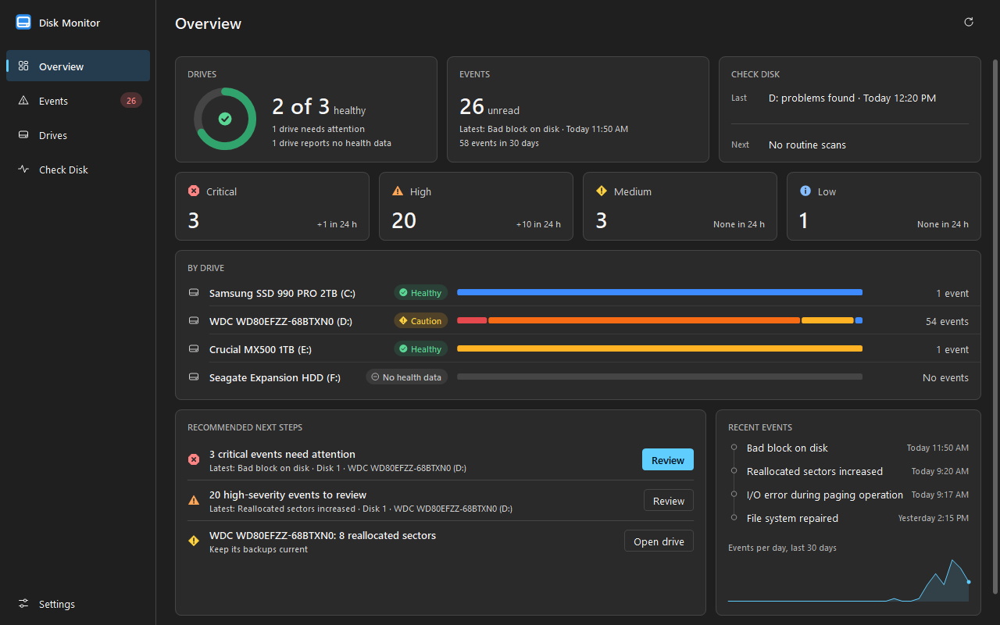
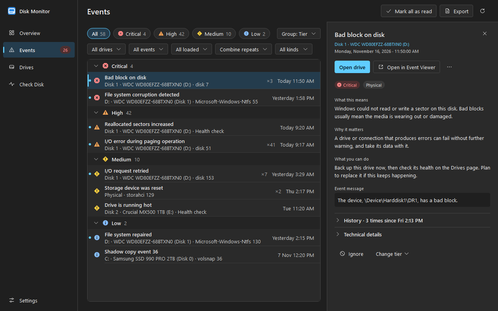
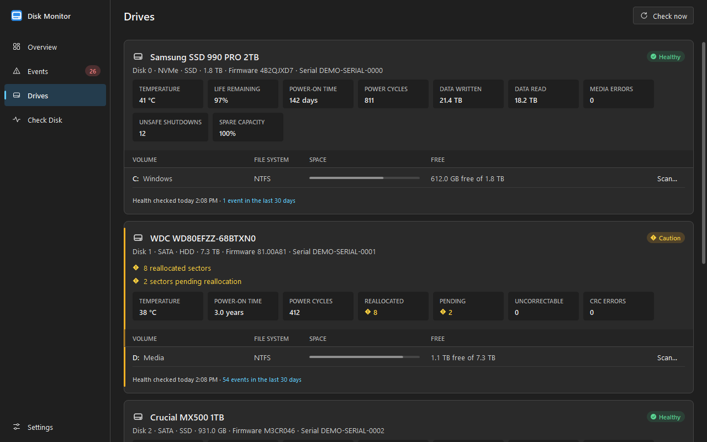

# Disk Monitor

<p align="center">
  
</p>

Disk Monitor watches the disks of a Windows PC and tells you, in plain language, when something goes
wrong. It reads the Windows event logs in real time for physical and file system errors, follows each
drive's own S.M.A.R.T. or NVMe health readings, sorts every problem into one of four tiers, and sends a
notification that leads straight to the event or to a scan of the affected volume. It lives in the
notification area, starts with Windows if you want it to, runs CHKDSK for you without a command prompt,
and updates itself from signed releases.

## Screenshots







The screenshots are rendered from demo data with `--render-screens`, so nothing in them describes a real
machine.

## Features

- **Real-time monitoring** of the System and Application event logs for disk, controller and file system
  errors, classified by a rule catalog into physical, file system, drive health and capacity problems.
- **Drive health** from S.M.A.R.T. and NVMe readings, read without administrator rights: reallocated and
  pending sectors, media errors, wear, temperature, spare capacity. A reading that gets worse raises an
  alert; a sleeping drive is never woken.
- **Four severity tiers** (Critical, High, Medium, Low), each with its own notification, sound and
  stay-on-screen options. Any kind of event can be moved to another tier or turned off.
- **Notifications** that open the event, or offer a scan of the volume, with quiet hours, snooze, repeat
  combining and a burst limit. Nothing in a notification repeats raw event text or file names.
- **CHKDSK from the app**: read-only scans with live output and progress, repairs with confirmation, and
  the result explained in one sentence.
- **Proactive checks**: a read-only scan after a file system error (at most once a day per volume),
  routine scans of fixed NTFS volumes on a schedule, and optional prompt-free scans through a registered
  task.
- **Notification-area app**: the icon shows the current state with a severity shape; the window is
  created only when you open it.
- **Start with Windows**, optionally straight into the notification area.
- **Recommended next steps**, a drive health page, a summary of what happened while it was not running,
  CSV export, and a self-check for troubleshooting.
- **Signed updates** from GitHub Releases: the manifest signature, then the installer's size and SHA-256
  are verified before anything is installed.

## How it decides severity

| Tier | Meaning | Examples |
|---|---|---|
| Critical | Data is being lost, or a drive says it is failing | Bad block on disk; data read does not match data written; drive failure predicted |
| High | Errors that need action soon | Disk controller error; I/O error during a paging operation; CHKDSK found file system problems |
| Medium | Warnings worth a look | Disk timed out; I/O request retried; storage device was reset |
| Low | Information and housekeeping | File system repaired; write cache enabled; crash dump written |

Each kind of event can be moved to another tier or turned off in Settings › Rules; the change applies
at once to the whole history and can be reset.

## Download

Get the latest build from [GitHub Releases](https://github.com/rockenrooster/DiskMonitor/releases).

- `DiskMonitor-Setup.exe`: the installer (recommended). Installing needs administrator rights.
- `DiskMonitor.exe`: the portable executable, one file.

Windows 10 22H2 or Windows 11, x64, with the
[.NET 10 Desktop Runtime (x64)](https://dotnet.microsoft.com/download/dotnet/10.0) installed. The
installer checks for it and stops, changing nothing, when it is missing.

## Design

The interface follows the design system Disk Monitor shares with MediaVerifier: custom-painted
components from one set of tokens, in dark, light and high contrast themes, at any display scale.


## Privileges

Disk Monitor runs as a standard user. It asks for administrator approval only for:

- **CHKDSK**: every scan and repair runs `chkdsk.exe` through a small elevated helper that accepts only
  a drive letter and a fixed mode.
- **Prompt-free scans** (optional, installed version only): registering a scheduled task once, so that
  read-only scans start without a prompt. Repairs always ask.
- **Installing** and installing updates.

## Build from source

Requirements: Windows x64, the .NET 10 SDK, and Inno Setup 6 only to build the installer locally.

```powershell
dotnet build DiskMonitor.sln
```

```powershell
dotnet run --project src/DiskMonitor
```

Check what Disk Monitor can see on this PC:

```powershell
.\src\DiskMonitor\bin\Debug\net10.0-windows\win-x64\DiskMonitor.exe --self-check
```

Build the single-file executable (and the installer, when Inno Setup is installed) into `artifacts\`:

```powershell
.\build.ps1 -NoIncrement
```

## Release notes for maintainers

```powershell
.\release.ps1 -Version X.Y.Z.W
```

`release.ps1` sets the version, promotes the `Unreleased` section of `CHANGELOG.md`, commits, pushes,
tags and pushes the tag; the release workflow builds and uploads the assets. The update manifest is
signed with the repository secret `DISKMONITOR_UPDATE_SIGNING_PRIVATE_KEY_PEM`; to sign a local build,
set `DISKMONITOR_UPDATE_SIGNING_PRIVATE_KEY_PEM_FILE` to the key file's path.

## Known limits

- Most USB bridges do not pass drive health data through; such drives show "No health data".
- Whether a volume is marked dirty is visible only when Disk Monitor runs as administrator.
- Some events are classified by their English message text.
- The binaries are not code-signed, so SmartScreen may warn on first run.

## Privacy

Disk Monitor reads the Windows event logs and drive health on this PC and sends nothing anywhere. Its
only network use is the update check against GitHub.

## License

No license file is currently included.
